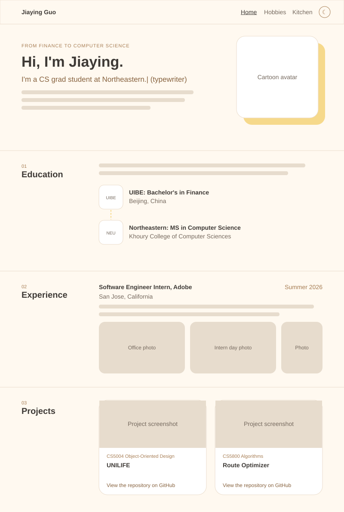
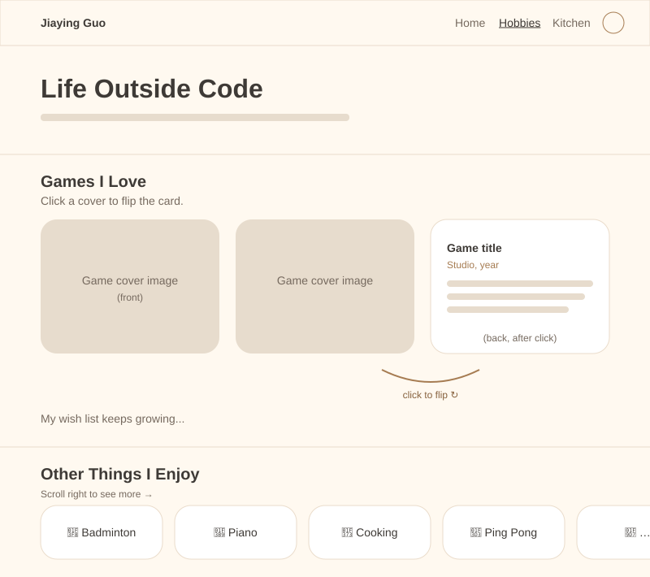
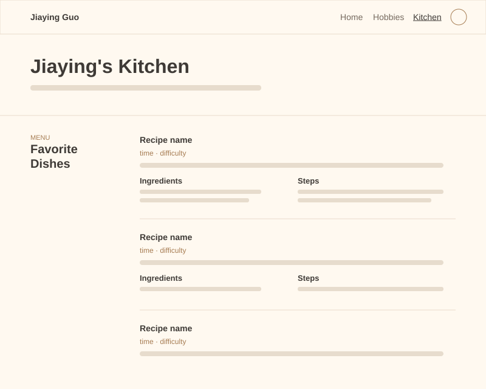
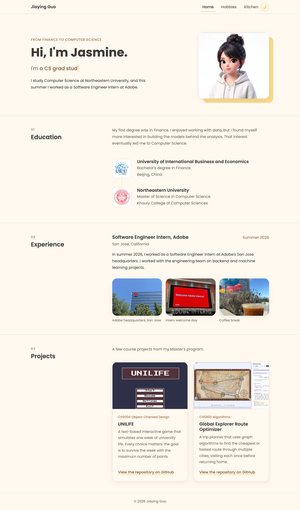
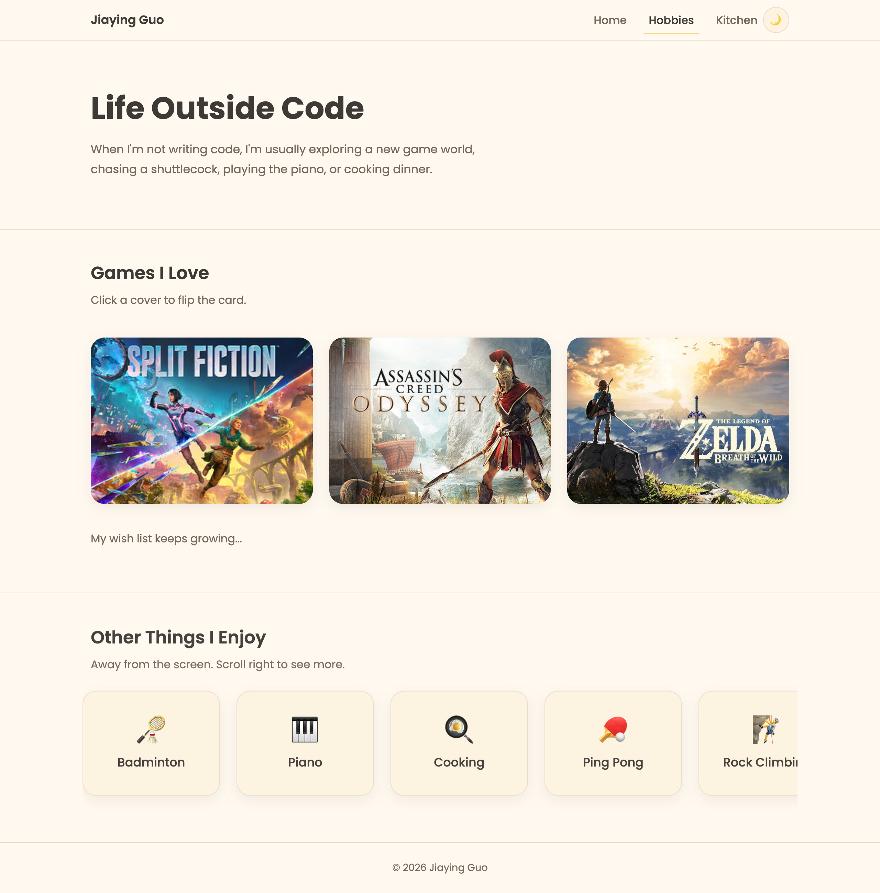
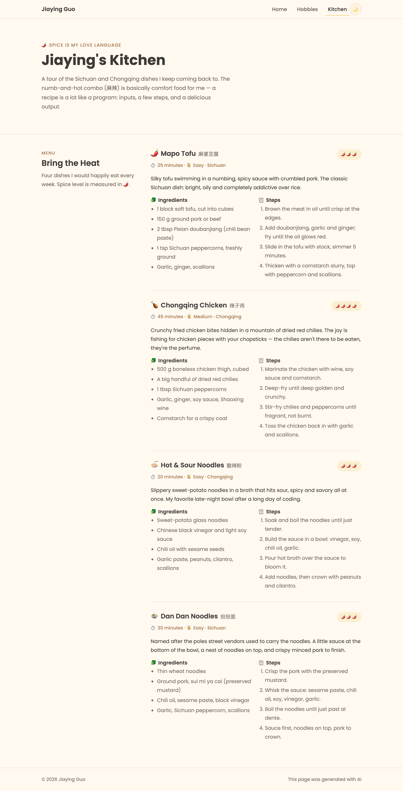

# Design Document: Jiaying Guo's Homepage

**Author:** Jiaying Guo
**Course:** CS5610 Web Development, Northeastern University
**Live site:** https://jasmine-g-uo.github.io/

---

## 1. Project Description

This project is my personal homepage, a static website built with vanilla HTML5, CSS3 and ES6 modules (no jQuery, no backend).

The homepage is a **personal brand** site that answers one question for every visitor: _"Who is Jiaying?"_ It tells the story of my switch **from Finance to Computer Science**: a bachelor's degree in Finance at the University of International Business and Economics (UIBE), a Master's in Computer Science at Northeastern University, and a Summer 2026 Software Engineer internship at Adobe in San Jose. It also shows course projects and the hobbies that make me who I am.

The site has three pages:

| Page         | URL            | Purpose                                                                                     |
| ------------ | -------------- | ------------------------------------------------------------------------------------------- |
| Home         | `index.html`   | Study and career: hero, Education (with school logos), Experience at Adobe, course Projects |
| Hobbies      | `hobbies.html` | Favorite video games as flip cards, plus a scrolling row of other hobbies                   |
| Kitchen (AI) | `kitchen.html` | A page generated with AI that shows the Sichuan dishes I love to cook                       |

**Projects featured on the home page:**

- **UNILIFE** (CS5004 Object-Oriented Design): a text-based interactive game that simulates one week of university life. The goal is to survive the week with the maximum points. [Repository](https://github.com/steviio/campus_adv)
- **Global Explorer Route Optimizer** (CS5800 Algorithms): uses graph algorithms to find the route that visits each city once and returns home with the minimum cost or time. [Repository](https://github.com/J0shuaL19/The-Global-Explorer-Route-Optimizer)

**Original features that make the site different:**

1. **Typewriter hero:** the hero line types and deletes phrases that describe me ("a CS grad student at Northeastern", "a former finance major", "a Summer 2026 intern at Adobe").
2. **Game flip cards:** each game card first shows only the cover art. Clicking it flips the card in 3D to reveal the description. Each card is a real `<button>`, so it also works with the keyboard.
3. **Light / dark theme:** a toggle button switches between a warm cream theme and a cozy cocoa dark theme. The choice is remembered with `localStorage`.
4. **Scroll reveal:** sections gently fade in as they scroll into view (disabled for users who prefer reduced motion).

**Design decisions:**

- **Privacy:** the site intentionally does not publish any contact information.
- **Layout:** a calm, editorial layout inspired by simple academic pages: left-aligned text, section headings in a left column, thin divider lines, and real images (school logos, project screenshots, game covers) instead of decorative icons.
- **Visual style:** warm and soft. Cream and milk-tea colors, a soft yellow accent, 20px rounded corners, light shadows and the Poppins font.

| Role              | Light mode | Dark mode |
| ----------------- | ---------- | --------- |
| Background        | `#FFF9F0`  | `#2A2420` |
| Card surface      | `#FFFFFF`  | `#362E28` |
| Text              | `#3E3A36`  | `#F3EDE4` |
| Primary (caramel) | `#A67C52`  | `#D9AB7C` |
| Accent (yellow)   | `#F6D98B`  | `#E9C46A` |

---

## 2. User Personas

### Persona 1: Emily Chen, the Recruiter

- **Age / Role:** 34, technical recruiter at a software company
- **Goals:** quickly understand a candidate's education, experience and projects before an interview
- **Frustrations:** generic portfolio sites that all look the same; walls of text
- **Tech comfort:** high; she browses on a laptop between meetings
- **What she needs from the site:** education, internship and projects, all within one scroll of the home page

### Persona 2: Marcus Johnson, the Classmate

- **Age / Role:** 26, CS5610 classmate who is also switching careers (from biology)
- **Goals:** get to know classmates, find teammates for projects, and get ideas for his own homepage
- **Frustrations:** hard to connect with people in large classes
- **Tech comfort:** medium; he often browses on his phone at night, in dark mode
- **What he needs from the site:** past course projects with links, shared interests like games, and creative web features

### Persona 3: Linda, the Family Member

- **Age / Role:** 55, a relative living in China
- **Goals:** see what her niece is studying and doing abroad
- **Frustrations:** small text, confusing navigation, too much technical jargon
- **Tech comfort:** low; she uses a tablet
- **What she needs from the site:** a simple, friendly page with pictures and a clear menu

---

## 3. User Stories

1. **The one-minute summary.** _As a recruiter, I want to understand a candidate's background at a glance, so that I can decide whether to schedule an interview._
   Emily opens the homepage between two meetings. The hero tells her the name, and the typewriter line cycles through "a CS grad student at Northeastern", "a former finance major" and "a Summer 2026 intern at Adobe". She scrolls once and sees the UIBE and Northeastern logos connected by a line. In less than a minute she knows the story.

2. **Checking real experience.** _As a recruiter, I want to see industry experience and real projects, so that I can judge practical skills._
   Emily keeps scrolling. The Experience section shows the Adobe internship with dates and location. The Projects section shows two course projects with screenshots. She clicks "View the repository on GitHub" under the Route Optimizer and looks at the code.

3. **Finding a teammate.** _As a classmate, I want to see what projects someone has already built, so that I can decide whether to team up for the next course project._
   Marcus sees that Jiaying built UNILIFE in CS5004 and a route optimizer in CS5800. He is taking CS5800 next semester, so he opens the repository to learn how the Held-Karp algorithm was visualized.

4. **Finding common ground.** _As a classmate, I want to discover shared hobbies, so that I have something to talk about before class._
   Marcus clicks **Hobbies** in the navigation bar. He sees three game covers and clicks the Zelda one. The card flips and shows why Jiaying loves Breath of the Wild. He plays it too, and the next day he starts a conversation about it.

5. **Browsing at night.** _As a classmate who reads on his phone at night, I want a dark mode, so that the page does not hurt my eyes._
   Marcus taps the moon button in the header. The whole site switches to a warm cocoa dark theme. When he opens the Kitchen page later, the site remembers his choice.

6. **Keyboard and touch friendly.** _As a visitor using a tablet or a keyboard, I want to flip the game cards without a mouse, so that I don't miss any content._
   On her tablet, Linda taps a game cover and it flips. A keyboard user can press Tab to reach a card and Enter to flip it, because every card is a real button.

7. **A taste of home.** _As a family member, I want to see what my niece enjoys in daily life, so that I feel connected to her while she studies abroad._
   Linda scrolls through the row of hobbies on the Hobbies page (badminton, piano, cooking and more), then taps **Kitchen** in the menu and finds a spicy tour of Sichuan and Chongqing dishes — mapo tofu, Chongqing chicken, hot & sour noodles and dan dan noodles. She smiles: Jiaying is still chasing the numb-and-hot flavors they used to share at family dinners.

---

## 4. Design Mockups

The mockups below are low-fidelity wireframes that define the layout, the navigation, and the placement of the interactive components. Layouts use the **Bootstrap 5 grid** (rows and columns) plus **Flexbox**. On small screens the two-column sections stack into a single column and the navigation collapses into a menu button.

### Home page (`index.html`)

### Hobbies page (`hobbies.html`)

### Kitchen page (`kitchen.html`, AI generated)

### Final result

| Home                                     | Hobbies                                       | Kitchen                                       |
| ---------------------------------------- | --------------------------------------------- | --------------------------------------------- |
|  |  |  |
